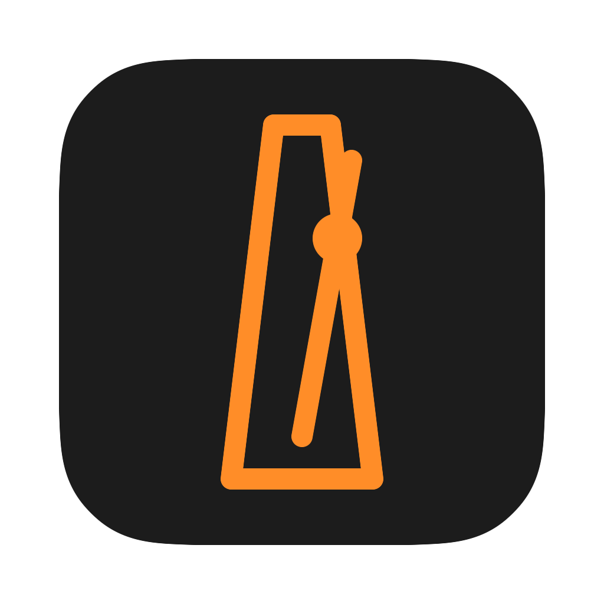

<p align="center"></p>

# Metro

A minimal macOS metronome. Set the tempo (buttons or arrow keys, shift for ±10), press Start (or space).

## Build

Needs the Xcode Command Line Tools only.

```sh
./build.sh && open build/Metro.app
```

The app is unsigned and built locally.

## License

[GPL-3.0](LICENSE)
